# 《爱在西元前》分镜板 — 待批版

> 这是**待您批准的一页到底版**：每个段落 = 歌词原句 + 现成画面的实拍帧（`AYXQ-SB/` 里，打开就能看）。
> 图=**已经出片的真实画面**，不是效果图。标 **【现成】** 的可以直接进片；**【要烧】** 的我批了就烧。
> 一句话：**80% 的画面已经完成，缺 5 条。**

---

## 一、这次只改了三件事

1. **男主"写词"变成一道完整工序**：泥板上打稿 → 石壁上落凿 → 最后一凿（都是现成素材，串起来即可）
2. **玻璃倒影从"毛病"改成"设计"**：她读碑时玻璃把她的脸和碑文叠在一起——她也成了碑文的一部分。全片只放三处；句8 的脸仍直接拍不借玻璃（一处叠一处不叠）
3. **镜头严格跟着歌词句序走**：唱"人潮"就给人潮、唱"女神"给女神像、唱"河"给水波

---

## 二、分镜板（按歌走）

### ① 前奏 0:00–0:31｜无词｜【现成 3 条】

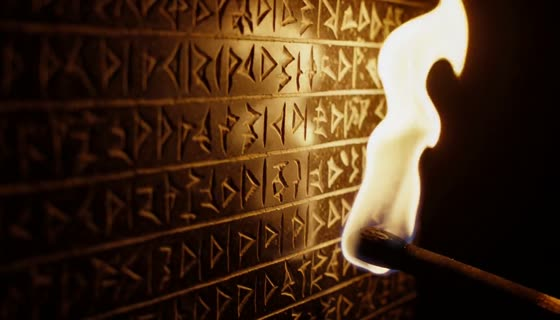 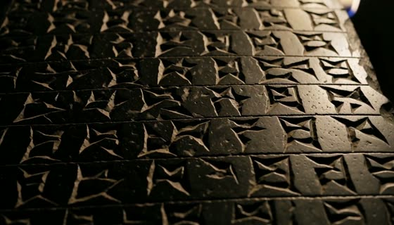 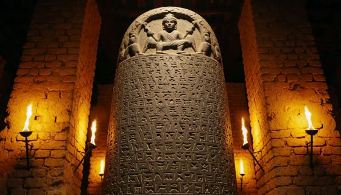

黑场 → 一束灯亮 → 光沿碑面刻痕走。**碑是主角，人是它身上的两个瞬间。**

---

### ② 句1–4「古巴比伦王…三千七百多年」0:31–0:47｜【现成 3 条】

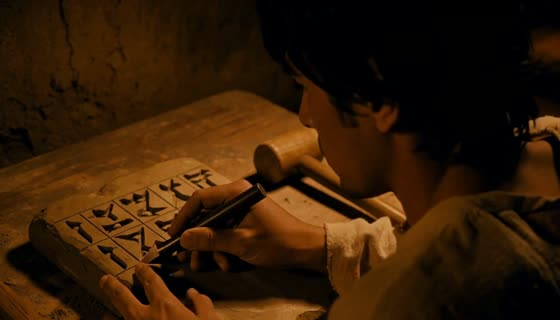 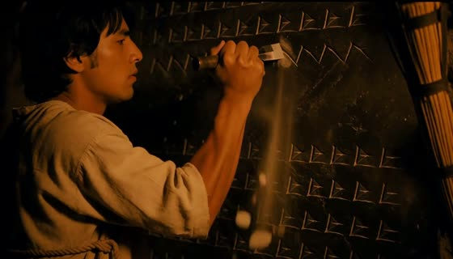 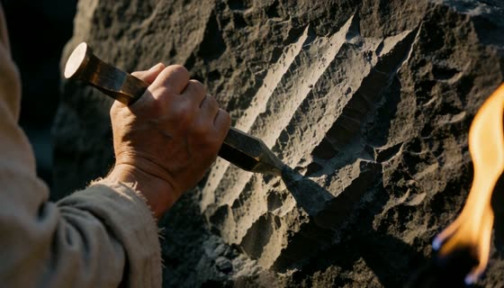

**在泥板上打稿（左）→ 刻到石壁上（中）→ 凿入石、石屑飞（右）。**
"法典刻在玄武岩上"不是一句词，是一道真实工序——他先在泥板上写字，再把字刻进石头。

---

### ③ 句5–8「你在橱窗前…你那张我深爱的脸」0:47–1:02｜【现成 2 条 + 要烧 1 条】

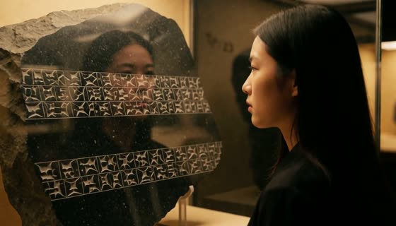 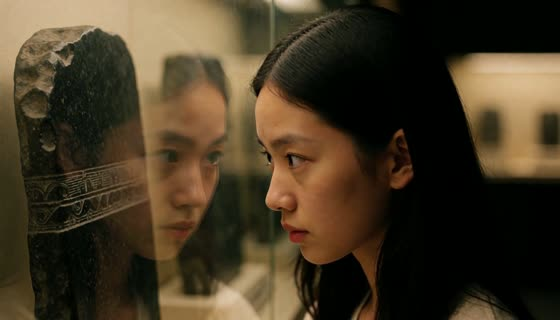

**她站在玻璃柜前读碑——玻璃里她的脸和碑文叠在一起（左）；她的侧脸贴着碑面（右）。**
这是全片最重要的一组：**她读的时候，自己被叠进了三千年前的字里。**
【要烧】句7"我在旁静静欣赏"——他（现代）在她身后虚焦入画，视线落在她身上。**1 条。**

---

### ④ 句9–10「祭司神殿征战／弓箭是谁的从前」1:02｜【现成 1 条】

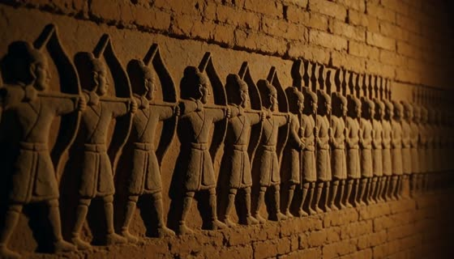

她抬眼看侧墙的弓箭手浮雕——**她看见的，是这场古代的入口。**

---

### ⑤ 句11–12「喜欢在人潮中／你只属于我的那画面」1:05｜【现成 2 条】

 

展厅人潮，她清晰、别人虚掉（左）→ 推近，人群散开只剩她（右）。**公共的展厅里，只剩她一个人。**

---

### ⑥ 句13–14「经过苏美女神身边／以女神之名许愿」1:08｜【现成 2 条】

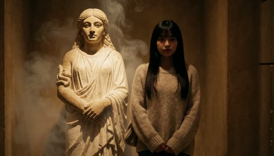 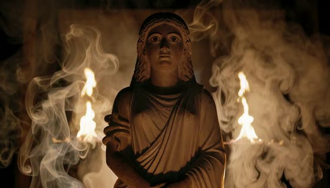

她经过女神像（左）；女神像与她的光一起暗下去（右）。**愿许了，但没拍出来——光暗就是许愿。**

---

### ⑦ 句15「思念像底格里斯河般的漫延」1:10｜【现成 2 条】

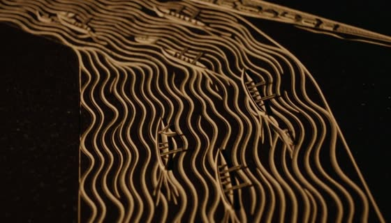 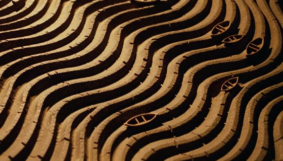

河纹浮雕化成水波（左）；河干涸（右）。**思念像河一样漫开，也像河一样干掉。**

---

### ⑧ 句16–17「难解的语言／永垂不朽的诗篇」1:12｜【现成 2 条】

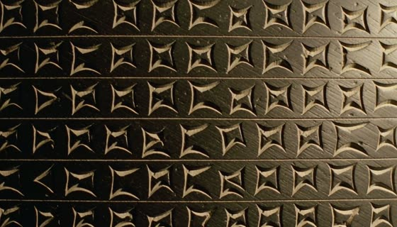 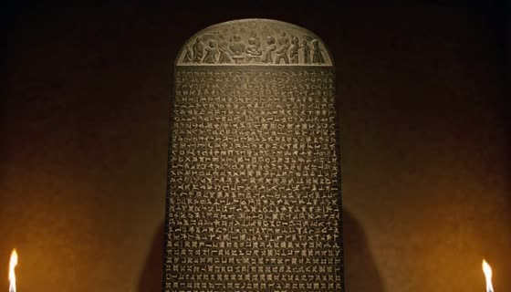

满墙楔形文字（左）；火光里字发亮、尘埃浮游（右）。**文字比人活得久——这一段的全部意思。**

---

### ⑨ 句18–19「爱写在西元前／深埋在美索不达米亚平原」1:17｜【现成 2 条】

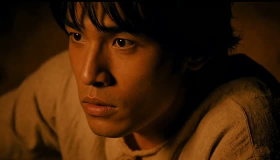 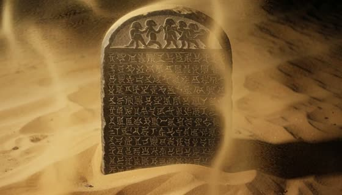

他执凿的侧脸（左）；沙土一铲铲盖过泥板（右）。**写下来，然后立刻埋掉。**

---

### ⑩ 句20–21「几十个世纪后出土发现／字迹依然清晰可见」1:24｜【现成 2 条】

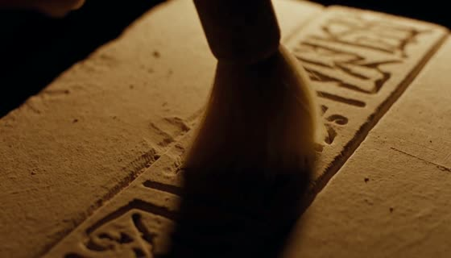 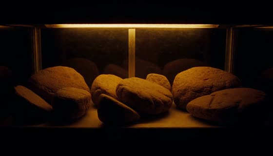

刷子扫开沙土、字浮现（左）；字在暖光里清清楚楚（右）。**出土是全片最温柔的动作——它对着古代的暴力刻凿。**

---

### ⑪ 句22–23「刻下了永远／风化千年的誓言」1:30｜【现成 2 条】

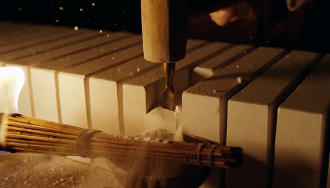 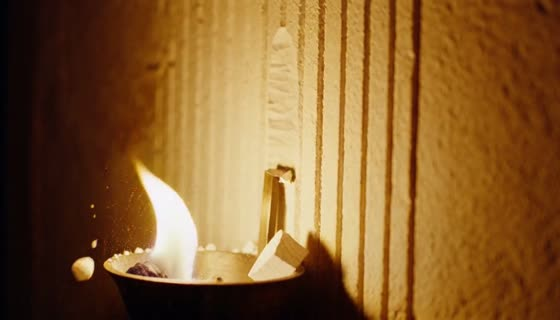

最后一凿定住、火星落下（左）；凿击爆发（右）。**"永远"刻完的那一秒，就是它开始风化的那一秒。**

---

### ⑫ 主歌2（重复·她读进去了）1:48–2:06｜【现成 2 条】

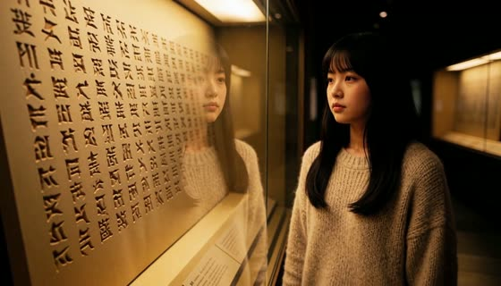 

她站在玻璃文字墙前——**玻璃里又是她的脸**（左）；她转身，这次是"第二次看见"（右）。

---

### ⑬ 副歌2（第二遍·沙）2:22–2:52｜【现成 2 条 + 要烧 2 条】

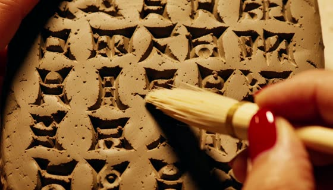 

**她的刷子**扫土（左）；沙继续埋（右）。这一遍的主题是"沙"。
【要烧】沙雨斜落、水面微波——**2 条**，撑这一遍的"沙"感。

---

### ⑭ 桥段（句25–26·他累了）2:52–3:07｜【现成 3 条】

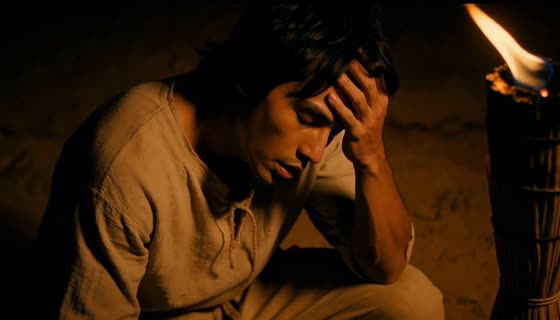 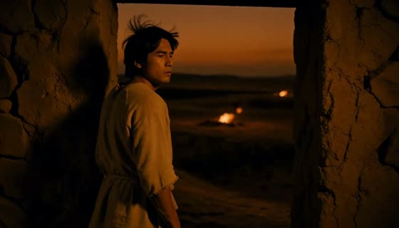 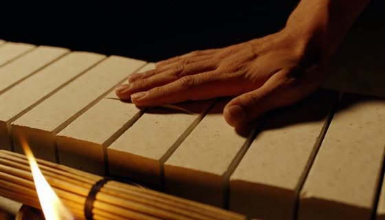

塌肩垂头、火把快烧完（左）→ 望向远处黑暗（中）→ **抬眼，眼里有火**（右）。
**全片的情感落点：不是爱得多深，是回不去了。**这段一个镜头都不缺。

---

### ⑮ 副歌3+4（终遍·重演）3:07–3:40｜【现成 3 条 + 要烧 1 条】

 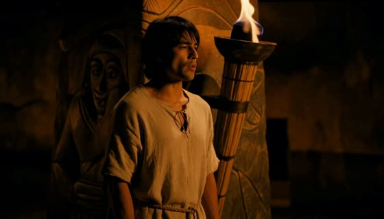 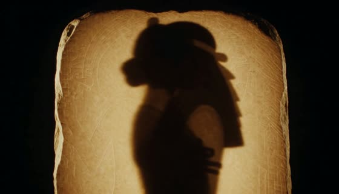

他开口唱（左）；火炬旁再唱（中）；**他与她隔着时空对望**（右）。之前的画面在这里重放一遍——**"一切又重演"。**
【要烧】**回环长镜**：回到开场一样的位置和构图，灯亮变灯暗（6.5s）——全片的门轴，**1 条**。

---

### ⑯ 尾声（句27·字还在）3:40–3:54｜【现成 1 条】

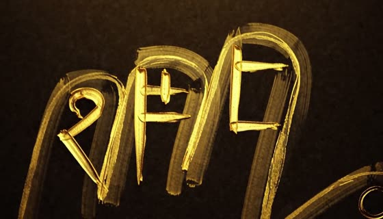

黑暗里，一行字还亮着，慢慢暗去。**人会没，字还在。**

---

## 三、批了我烧什么（5 条）

| # | 要烧的镜头 | 为什么必须有 |
|---|---|---|
| 1 | **回环长镜**（开场同构图·灯亮→灯暗·6.5s） | 全片结构门轴，没有它"一切又重演"不成立 |
| 2 | **句7 他（现代）虚焦入画看她** | 注视链里"他看她"这一环，现在缺 |
| 3 | **沙雨斜落** | 副歌2 的"沙"主题 |
| 4 | **水面微波**（禁人脸） | 副歌2 的"埋/洗"意象 |
| 5 | **金色字符墙**（或拿现有文字墙调金） | 预副2 的"金字"档位 |

烧完 5 条后：按句序装配成片（先出 540P 粗剪给您看，过关再出正片档）。

---

## 四、请您批三件事

1. **叙事方向**：一块石头讲三千年、字比人活得久——这个方向对不对？
2. **玻璃倒影做母题**：她的脸和碑文叠在一起（三处），句8 的脸单独直接拍——行不行？
3. **男主写词三级**：泥板打稿→石壁落凿→最后一凿——认不认？

三件都点头，我就烧那 5 条、出粗剪。有任何一件不对，说一句我改文档，不动素材。

---
*本件为待批分镜板：图为现有片段实帧；生产明细见 `爱在西元前-MASTER-叙事分镜总档-v1.md`。*
